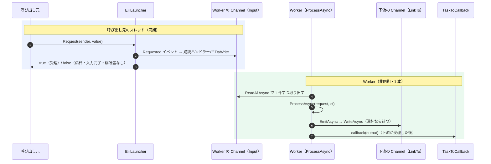

# Eiii — Event-drIven Independent task Infrastructure

イベントで受け取った**型付きの要求**を、**独立した非同期 Worker** が処理し、**型付きの出力**を次の Worker や **delegate のコールバック**へ渡す。複数の Worker を**名前で一元管理**する。Eiii はこの組み合わせを C# / .NET 10 で最小限に実装した、学習と実験のためのプロジェクトです。

- 2018 年に作った原型（`EventImplementedInduceInterface`）を、設計の意図を保ちながら段階的に作り直しました（Phase 2）。
- 通信機器（Lantronix XPort 系を想定）を相手にする処理を題材に、受信・フレーム確定・解析を Worker に分けて協調させる実験を含みます。
- 製品として使うためのライブラリではありません。動作の観察と、設計判断の比較が目的です。

> このリポジトリの `refactor/phase2` ブランチの内容です。`master` は原型のまま残しています。

---

## 現在の状態

| 区分 | 内容 |
|---|---|
| 実装済み | ライブラリ本体（`src/Eiii`）、原型 Main の移植サンプル、通信シミュレーター（CR 終端方式・時間経過方式）、操作できるデモ（`Eiii.DemoConsole`） |
| テスト | xUnit で 4 プロジェクト・計 103 件（原型の特性 11、ライブラリ 46、通信 34、デモ 12）。Debug / Release とも成功した実行結果を確認済み |
| 未実装 | 一時停止（Pause / Resume）、Single 実行、実行報告（処理中の要求の記録）、再送や重複排除、Worker 間の依存関係の自動解析 |
| 未検証 | 実際のキー入力による DemoConsole の全画面表示と操作（自動検証は標準入力による行単位表示のみ）。Windows 以外の OS |

---

## ディレクトリ構成

```
/                         原型（2018 年版）のソース。変更しない。名前空間は EventImplementedInduceInterface
├─ legacy/                原型をそのままビルドするためのプロジェクト（ソースはリンク参照のみ）
├─ src/Eiii/              ライブラリ本体（名前空間 Eiii）
├─ samples/
│  ├─ Eiii.Sample/        原型の Main を新しい API で移植したコンソールサンプル
│  ├─ Eiii.Comm/          通信用の部品（フレーム確定・解析・受信 Worker・模擬機器）。名前空間は Eiii.CommSim
│  ├─ Eiii.CommSim/       通信シミュレーター（7 つのシナリオを順に実行）        → samples/Eiii.CommSim/README.md
│  └─ Eiii.DemoConsole/   人が操作して観察するデモ（架空の XPort 機器）        → samples/Eiii.DemoConsole/README.md
└─ tests/
   ├─ Eiii.Legacy.Tests/  原型の現在の動作を記録する特性テスト
   ├─ Eiii.Tests/         ライブラリのテスト
   ├─ Eiii.CommSim.Tests/ 通信部品のテスト
   └─ Eiii.DemoConsole.Tests/ デモの構成（画面以外）のテスト
```

---

## ライブラリの部品（`src/Eiii`）

| 型 | 役割 |
|---|---|
| `EiiiWorker` | 入出力型に依存しない寿命制御。`Start` / `StopAsync` / `RestartAsync` / `CompleteInput`。状態は実際の Task（`Execution`）と `IsRunning` で観測する |
| `EiiiWorker<TIn, TOut>` | 容量制限付きの `Channel<TIn>` を 1 本のワーカーが読み、`ProcessAsync` で 1 件ずつ処理し、`EmitAsync` で `TOut` を出力する |
| `ILauncher<T>` / `EiiiLauncher<T>` | 呼び出し元の代理として要求のイベント `Requested` を発行し、受理されたかを bool で返す |
| `EiiiEventArgs<T>` | 要求の値（`Value`）と、受信側が書き戻す受理結果（`Accepted`） |
| `EventHandler<TSender, TEventArgs>` | 原型から引き継いだ独自のデリゲート（比較学習のため維持） |
| `TaskToCallback<TOut>` | 出力を観測するコールバック。Worker のスレッドで同期的に呼ばれる |
| `EiiiWorkerRegistry` | 入出力型の異なる Worker を名前で登録・取得し、一括で起動・停止・正常終了する |

### 要求から結果までの流れ



### 動作原理の要点

- **イベントは同期、Worker は非同期。** `Request` を呼ぶと、イベントの購読ハンドラーが呼び出し元のスレッドで `TryWrite` を行い、その結果がすぐに返ります。処理は Worker が後で、呼び出し元とは独立に行います（非同期は「必ず別スレッドで動く」という意味ではありません。Worker がスレッドプールで動くのは `Task.Run` で起動しているためです）。
- **データを黙って捨てない。** キューは `BoundedChannelFullMode.Wait` です。同期の投入（`TryWrite` / `Request`）は満杯なら false を返し、非同期の投入（`WriteAsync`）は空きが出るまで待ちます。下流が詰まると上流の `EmitAsync` が待つので、待ちが上流へ伝わります（バックプレッシャー）。
- **状態は実際の Task で観測する。** 実行中の `Execution.Status` は `Running` ではなく `WaitingForActivation` です（`Task.Run(Func<Task>)` が返す代理 Task のため）。判定には `IsRunning`（未完了なら true）を使います。終了後は `RanToCompletion`（正常終了）、`Canceled`（停止）、`Faulted`（例外。原因は `Exception`）になります。
- **正常終了と停止は別物。** `CompleteInput` は入力を閉じ、受理済みの要求をすべて処理してから終わり、`LinkTo` 先にも完了を伝えます。`StopAsync` はキャンセルによる中断で、**処理中だった 1 件は失われ得ます**。まだ読み出していない要求は Channel に残り、次の `Start` で処理されます。
- **多重起動しない。** `Start` は実行中なら何もしません。CTS は実行ごとに作り、取消（`CancelAsync`）と破棄を同じ lock の中で行います。破棄は、実行とキャンセルコールバックの両方が終わった時点で 1 回だけです（テストで確認済み）。
- **Registry は便宜機能。** 一括操作は「一直線に接続し、上流から順に登録した構成」でだけ正しい順序になります。依存関係の解析はしません。

### 最小の使用例

```csharp
using Eiii;

var worker = new TimesTen(capacity: 8, callback: new TaskToCallback<int>(v => Console.WriteLine(v)));
var launcher = new EiiiLauncher<int>();
worker.Attach(launcher);              // イベントを購読（Launcher と Worker は 1 対 1）
worker.Start();

bool accepted = launcher.Request(sender: "main", value: 1);   // 同期: 受理されたかがすぐ返る
await worker.Input.WriteAsync(2);                               // 非同期: 満杯なら空くまで待つ

worker.CompleteInput();               // 残りを処理して正常終了
await worker.Execution!;              // → 10, 20 が表示され、Status は RanToCompletion

// トップレベル文の後に型を宣言する（Program.cs にそのまま貼り付けて動かせる）
// int を受けて 10 倍した int を出力する Worker
sealed class TimesTen(int capacity, TaskToCallback<int> callback) : EiiiWorker<int, int>(capacity, callback)
{
    protected override ValueTask ProcessAsync(int request, CancellationToken cancellationToken)
        => EmitAsync(request * 10, cancellationToken);
}
```

---

## 原型（2018 年版）との主な違い

| 観点 | 原型 | Phase 2 |
|---|---|---|
| 要求の処理 | イベントハンドラーが呼び出し元のスレッドで同期的に処理していた | ハンドラーは Channel に積むだけで、Worker が非同期に処理する |
| 型 | `eventFunc<T>` のメソッド型パラメーターがクラスの `T` を隠し、`as` キャストが必要だった | `EiiiWorker<TIn, TOut>`。型の誤りはコンパイル時に検出される |
| 出力 | `TaskToCallback(string)`（周期ループのカウンタだけ） | `TOut` を `EmitAsync` で下流の Channel とコールバックへ |
| 状態 | 実行中でも `GetStatus()` が `Faulted` を返した | `Execution.Status` と `IsRunning` |
| 再起動 | キャンセルして 1.2 秒待ち、戻り値を捨てて起動 | 終了を待ってから起動。並行に呼ばれても Worker は 1 本 |
| 例外 | ループが黙って止まり、再起動もできなくなった | `Faulted` になり原因が残る。再び `Start` できる |
| 一元管理 | 同じ型 `T` の Worker しか登録できず、重複した名前でも要素が残った | 型の異なる Worker を登録できる。重複は `ArgumentException` |
| 周期処理・Single・TSKCTRL | あり（Single はループが 0 回、PAUSE 等は宣言のみ） | ライブラリからは外した。周期の処理は必要なサンプル側で `PeriodicTimer` を使う |

原型の挙動は `tests/Eiii.Legacy.Tests` に記録しています（欠陥も「現在の動作」として記録）。

---

## ビルドとテスト

.NET 10 SDK が必要です。

```
dotnet build Eiii.slnx
dotnet test Eiii.slnx
dotnet test Eiii.slnx -c Release
```

| テストプロジェクト | 件数 | 主な内容 |
|---|---|---|
| `Eiii.Legacy.Tests` | 11 | 原型の動作の記録（意図・欠陥・不明に分類） |
| `Eiii.Tests` | 46 | 状態の観測、正常終了と停止、満杯時の動作、多重起動の防止、CTS の解放、Launcher と Callback、Registry |
| `Eiii.CommSim.Tests` | 34 | CR 終端と時間経過のフレーム確定、バックプレッシャー下でも受信時刻で判定されること |
| `Eiii.DemoConsole.Tests` | 12 | コマンドの直列化、無応答、誤分割や遅れた応答による取り違え、再起動、正常終了 |

> 開発に使った Windows 環境では Smart App Control が有効で、新しくビルドした DLL の読み込みがときどき拒否されました。その回は「未検証」として扱い、設定の変更や回避はしていません。上の件数は、読み込みが許可された回で Debug / Release とも成功を確認したものです。

---

## サンプル

| サンプル | 実行方法 | 内容 |
|---|---|---|
| `Eiii.Sample` | `dotnet run --project samples/Eiii.Sample` | 原型の Main の移植。Space で要求、B で 6 件、R で再起動、Esc で正常終了 |
| `Eiii.CommSim` | `dotnet run --project samples/Eiii.CommSim` | 通信シミュレーター。詳しくは [samples/Eiii.CommSim/README.md](samples/Eiii.CommSim/README.md) |
| `Eiii.DemoConsole` | `dotnet run --project samples/Eiii.DemoConsole` | 操作して観察するデモ。詳しくは [samples/Eiii.DemoConsole/README.md](samples/Eiii.DemoConsole/README.md) |

---

## 既知の制約

仕様として受け入れている制限です（解消のための機能は追加していません）。

- `StopAsync`（キャンセル）では処理中の 1 件が失われ得ます。1 件から複数の出力を作る途中だった場合は、まだ渡していない出力も失われます。
- Launcher と Worker は 1 対 1 です。`Request` は待たず、満杯なら false を返します（再送は呼び出し元の判断）。
- コールバックは「出力が下流の Channel に受理されたこと」を示し、下流での処理完了は保証しません。
- ワーカーの中から自分の `StopAsync` / `RestartAsync` を await すると止まります（禁止事項。検出はしません）。
- 容量 0 の Channel は、バッファを持たない受け渡しになります（.NET 10 の `BoundedChannel` の仕様）。
- 通信シミュレーターとデモの制約は、それぞれの README を参照してください。

## ライセンス

[LICENSE](LICENSE) を参照してください。
