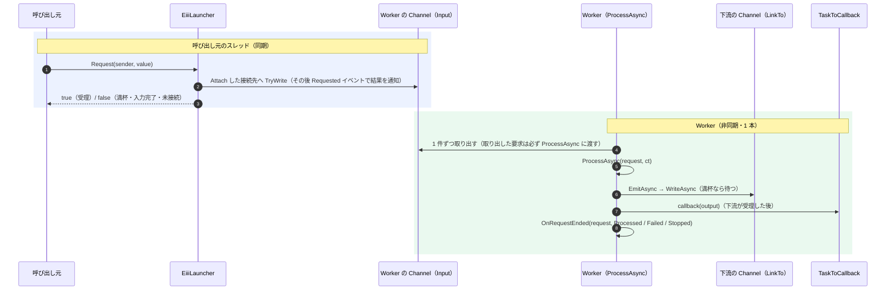
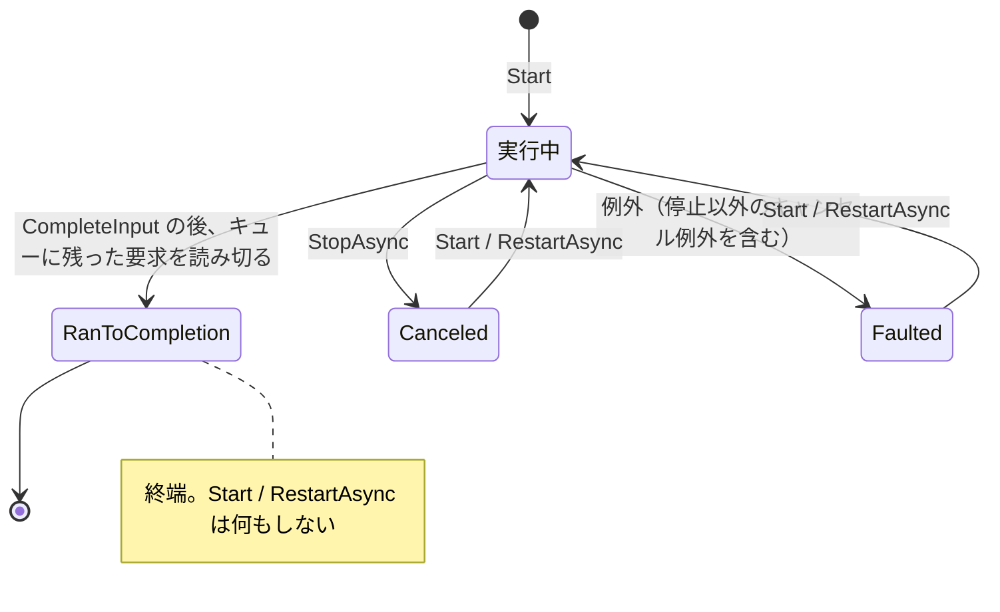

# Eiii — Event-drIven Independent task Infrastructure

イベントで受け取った**型付きの要求**を、**独立した非同期 Worker** が処理し、**型付きの出力**を次の Worker や **delegate のコールバック**へ渡す。複数の Worker を**名前で一元管理**する。Eiii はこの組み合わせを C# / .NET 10 で最小限に実装した、学習と実験のためのプロジェクトです。

- 2018 年に作った原型（`EventImplementedInduceInterface`）を、設計の意図を保ちながら段階的に作り直しました（Phase 2）。その後、停止・終了・通知の契約を見直す「第二次改良」を行いました。以前の版からの変更と移行の方法は [RELEASE-NOTES.md](RELEASE-NOTES.md)（移行ノート）を参照してください。
- 通信機器（Lantronix XPort 系を想定）を相手にする処理を題材に、受信・フレーム確定・解析を Worker に分けて協調させる実験を含みます。
- 製品として使うためのライブラリではありません。動作の観察と、設計判断の比較が目的です。

> このリポジトリの `refactor/phase2` ブランチの内容です。`master` は原型のまま残しています。このブランチでも、原型のソースは `legacy/` に変更せずに残しています。

---

## 現在の状態

| 区分 | 内容 |
|---|---|
| 実装済み | ライブラリ本体（`src/Eiii`）、原型 Main の移植サンプル、通信シミュレーター（CR 終端方式・時間経過方式）、操作できるデモ（`Eiii.DemoConsole`） |
| テスト | xUnit で 4 プロジェクト・計 207 件（原型の特性 11、ライブラリ 101、通信 83、デモ 12）。Debug / Release ともすべて成功（2026-10-14） |
| 未実装 | 一時停止（Pause / Resume）、Single 実行、実行報告（処理中の要求の記録）、再送や重複排除、Worker 間の依存関係の自動解析 |
| 未検証 | 実際のキー入力による DemoConsole の全画面表示と操作（自動検証は標準入力による行単位表示のみ）。Windows 以外の OS |

---

## ディレクトリ構成

```
/                         Eiii.slnx、README、RELEASE-NOTES、LICENSE
├─ legacy/                原型（2018 年版）のソースと、それをそのままビルドするプロジェクト。変更しない。名前空間は EventImplementedInduceInterface
├─ src/Eiii/              ライブラリ本体（名前空間 Eiii）
├─ samples/
│  ├─ Eiii.Sample/        原型の Main を新しい API で移植したコンソールサンプル
│  ├─ Eiii.Comm/          通信用の部品（フレーム確定・解析・受信 Worker・模擬機器）。名前空間は Eiii.CommSim
│  ├─ Eiii.CommSim/       通信シミュレーター（7 つのシナリオを順に実行）        → samples/Eiii.CommSim/README.md
│  └─ Eiii.DemoConsole/   人が操作して観察するデモ（架空の XPort 機器）        → samples/Eiii.DemoConsole/README.md
└─ tests/
   ├─ Eiii.Legacy.Tests/  原型の現在の動作を記録する特性テスト
   ├─ Eiii.Tests/         ライブラリのテスト
   ├─ Eiii.CommSim.Tests/ 通信部品のテスト
   └─ Eiii.DemoConsole.Tests/ デモの構成（画面以外）のテスト
```

---

## ライブラリの部品（`src/Eiii`）

| 型 | 役割 |
|---|---|
| `EiiiWorker` | 入出力型に依存しない寿命制御。`Start` / `StopAsync` / `RestartAsync` / `CompleteInput` / `CompleteAsync`。状態は実際の Task（`Execution`）と `IsRunning`、キューの残りは `PendingCount` で観測する |
| `EiiiWorker<TIn, TOut>` | 容量制限付きの `Channel<TIn>`（`Input`）を 1 本のワーカーが読み、`ProcessAsync` で 1 件ずつ処理し、`EmitAsync` で `TOut` を出力する。`LinkTo` で下流の入力口へ一度だけ接続する。`OnInputCompletedAsync`（入力の完了時）と `OnRequestEnded`（要求 1 件の終わり方）を上書きできる |
| `RequestEnd` | `OnRequestEnded` に渡す、要求 1 件の終わり方（`Processed` / `Failed` / `Stopped`） |
| `ILauncher<T>` / `EiiiLauncher<T>` | 呼び出し元の代理として、`Attach` した単一の接続先（Worker の `Input` など）へ要求を投入し、受理されたかを bool で返す。結果は `Requested` イベントでも通知する（観測用） |
| `EiiiEventArgs<T>` | 要求の値（`Value`）と、投入で確定した受理結果（`Accepted`、読み取り専用） |
| `EventHandler<TSender, TEventArgs>` | 原型から引き継いだ独自のデリゲート（比較学習のため維持） |
| `TaskToCallback<TOut>` | 出力を観測するコールバック。Worker のスレッドで同期的に呼ばれる |
| `EiiiWorkerRegistry` | 入出力型の異なる Worker を名前で登録・取得し、登録順に列挙する（起動・停止・完了の順序は利用者が決める） |

### 要求から結果までの流れ



### Worker のライフサイクル



| 状態（`Execution`） | 意味 | 次に起動できるか |
|---|---|---|
| null | 未起動 | `Start` で起動する |
| 未完了（`IsRunning` が true） | 実行中（停止の処理中を含む） | `Start` は何もしない（多重起動しない） |
| `RanToCompletion` | 正常終了（入力が閉じられ、この実行がキューに残っていた要求を読み切り、`OnInputCompletedAsync` と完了の伝播まで終えた。以前の実行で中断・失敗した要求が処理し直されたことは表さない） | しない（終端。入力は二度と開けない） |
| `Canceled` | `StopAsync` による停止 | `Start` / `RestartAsync` で再開する。キューに残った要求は受理順に処理される |
| `Faulted` | 例外で終了。原因は `Execution.Exception` | `Start` / `RestartAsync` で再開する |

### 動作原理の要点

- **イベントは同期、Worker は非同期。** `Request` を呼ぶと、Launcher が呼び出し元のスレッドで接続先へ `TryWrite` を行い、その結果がすぐに返ります。`Requested` イベントは、受理の結果が確定した後に観測のために発火します。処理は Worker が後で、呼び出し元とは独立に行います（非同期は「必ず別スレッドで動く」という意味ではありません。Worker がスレッドプールで動くのは `Task.Run` で起動しているためです）。
- **データを黙って捨てない。** キューは `BoundedChannelFullMode.Wait` です。同期の投入（`TryWrite` / `Request`）は満杯なら false を返し、非同期の投入（`WriteAsync`）は空きが出るまで待ちます。下流が詰まると上流の `EmitAsync` が待つので、待ちが上流へ伝わります（バックプレッシャー）。
- **状態は実際の Task で観測する。** 実行中の `Execution.Status` は `Running` ではなく `WaitingForActivation` です（`Task.Run(Func<Task>)` が返す代理 Task のため）。判定には `IsRunning`（未完了なら true）を使います。
- **Canceled は停止だけを表す。** `ProcessAsync` などからキャンセル例外が出たとき、その時点で `StopAsync` による停止が要求されていなければ、`InvalidOperationException` に包まれ（元の例外は `InnerException`）、`Faulted` になります。
- **正常終了と停止は別物。** `CompleteInput` は入力を閉じ、Worker はキューに残っている要求を読み切り、`OnInputCompletedAsync` を呼んでから正常終了します。以前の実行で停止や例外によって中断した要求を、処理し直すことはしません。正常な完了は停止の要求ではありません。`CompleteInput` は入力を閉じるだけで、終了を待ちません（終了は `Execution` で観測します）。`CompleteAsync` は入力を閉じ、呼び出した時点のその Worker 自身の実行の終了を待ちます（次の項と、下の「既知の制約」）。`LinkTo` で完了の伝播を指定していれば（既定）、下流の入力も閉じます。`StopAsync` はキャンセルによる中断です。
- **`CompleteAsync` が待つのはその Worker だけ。** `CompleteAsync` は入力を閉じ、呼び出した時点のその Worker 自身の実行（`Execution`）の終了を待ちます。true はその実行が正常終了（`RanToCompletion`）したこと、false はその実行が正常終了しなかったこと（未起動、`Faulted`、`Canceled`）を表します。例外は再スローしないので、原因は `Execution` で確かめます。`LinkTo` 先の Worker の処理の完了は待たず、保証もしません。パイプライン全体の完了を待つには、上流から順に各 Worker の `CompleteAsync` を呼びます（下の「Worker をつなぐ例」。下流が出力を受け取れることが前提です。下の「既知の制約」）。下流の `CompleteAsync` も自分の入力を閉じるので、`propagateCompletion: false` で接続した場合（上流が正常終了しても下流の入力は閉じない）でも、すべての上流の `CompleteAsync` が終わった後に下流の `CompleteAsync` を呼べば、下流の入力が閉じて完了まで待てます。上流が終わる前に下流の入力を閉じると、上流の `EmitAsync` の書き込みが失敗し、上流は `Faulted` になります。
- **取り出した要求は捨てない。** Worker が取り出した要求は、停止と競合しても必ず `ProcessAsync` に一度だけ渡されます（取り消し済みのトークンで渡ることがあります）。処理を続けるか中断するかは `ProcessAsync` が決めます。まだ取り出していない要求はキューに残り、次の `Start` で処理されます。
- **要求ごとの終わり方を通知する。** `OnRequestEnded` は `ProcessAsync` の呼び出しごとにちょうど 1 回、`Processed`（return した）、`Failed`（例外。Worker は Faulted）、`Stopped`（停止の要求中にキャンセル例外。フックが正常に戻れば Worker は Canceled）で呼ばれます。`Processed` は業務上の成功を表しません。「ちょうど 1 回」は呼び出しの回数の保証で、通知を受けた側の処理が終わったことの保証ではありません。フックが例外を投げると、どの終わり方でも Worker は `Faulted` になります。
- **多重起動しない。** `Start` は実行中なら何もしません。CTS は実行ごとに作り、取消（`CancelAsync`）と破棄を同じ lock の中で行います。破棄は、実行とキャンセルコールバックの両方が終わった時点で 1 回だけです（テストで確認済み）。
- **Worker を生かしておくのは利用者。** `Start` は Worker の生存を保証しません。外部から到達できなくなった実行中の Worker は、GC に回収されることがあります。Worker またはその所有者への参照を、必要な期間保持してください。
- **Registry は名簿。** 登録・取得・列挙（`GetAll` は登録順のスナップショット）だけを行います。登録順は依存関係の順序を意味しません。起動・停止・完了の順序は、接続の構成に合わせて利用者が Worker ごとに決めます（直列なら、起動は下流から、`StopAsync` / `CompleteAsync` は上流から 1 つずつ）。

### 最小の使用例

```csharp
using Eiii;

var worker = new TimesTen(capacity: 8, callback: new TaskToCallback<int>(v => Console.WriteLine(v)));
var launcher = new EiiiLauncher<int>();
using var attachment = launcher.Attach(worker.Input);   // 接続先は 1 つ。Dispose で接続を外す（Worker は止めない）
worker.Start();

bool accepted = launcher.Request(sender: "main", value: 1);   // 同期: 受理されたかがすぐ返る
await worker.Input.WriteAsync(2);                               // 非同期: 満杯なら空くまで待つ

bool completed = await worker.CompleteAsync();   // 入力を閉じ、残りを処理して正常終了するのを待つ → 10, 20 が表示される。completed は true

// トップレベル文の後に型を宣言する（Program.cs にそのまま貼り付けて動かせる）
// int を受けて 10 倍した int を出力する Worker
sealed class TimesTen(int capacity, TaskToCallback<int> callback) : EiiiWorker<int, int>(capacity, callback)
{
    protected override ValueTask ProcessAsync(int request, CancellationToken cancellationToken)
        => EmitAsync(request * 10, cancellationToken);
}
```

### Worker をつなぐ例（`LinkTo` と `OnRequestEnded`）

```csharp
using Eiii;

var length = new Length(capacity: 4, callback: new TaskToCallback<int>(n => Console.WriteLine($"length {n}")));
var trim = new Trim(capacity: 4);
trim.LinkTo(length.Input);   // 一度だけ。出力を始める前（Start の前）に接続する。既定では正常終了を下流へ伝える

length.Start();              // 起動は下流から
trim.Start();

trim.Input.TryWrite("  abc ");
trim.Input.TryWrite("de");

bool upstream = await trim.CompleteAsync();     // 完了は上流から。待つのは trim の終了だけ（正常終了で length の入力も閉じる）
bool downstream = await length.CompleteAsync(); // length が残りを処理し終えるのは、ここで待つ
Console.WriteLine($"{upstream} {downstream}");  // → length 3、length 2、True True

// 文字列の前後の空白を除いて下流へ渡す Worker
sealed class Trim(int capacity) : EiiiWorker<string, string>(capacity)
{
    protected override ValueTask ProcessAsync(string request, CancellationToken cancellationToken)
        => EmitAsync(request.Trim(), cancellationToken);

    protected override void OnRequestEnded(string request, RequestEnd ending, Exception? exception)
        => Console.WriteLine($"trim [{request}] {ending}");   // Worker のスレッドで、次の要求の前に同期的に呼ばれる
}

// 文字列の長さを出力する Worker
sealed class Length(int capacity, TaskToCallback<int> callback) : EiiiWorker<string, int>(capacity, callback)
{
    protected override ValueTask ProcessAsync(string request, CancellationToken cancellationToken)
        => EmitAsync(request.Length, cancellationToken);
}
```

`trim` と `length` は独立に動くため、`trim [...] Processed` と `length ...` の行の前後関係は実行ごとに変わることがあります。

---

## 原型（2018 年版）との主な違い

| 観点 | 原型 | Phase 2 |
|---|---|---|
| 要求の処理 | イベントハンドラーが呼び出し元のスレッドで同期的に処理していた | Launcher は Channel に積むだけで、Worker が非同期に処理する |
| 型 | `eventFunc<T>` のメソッド型パラメーターがクラスの `T` を隠し、`as` キャストが必要だった | `EiiiWorker<TIn, TOut>`。型の誤りはコンパイル時に検出される |
| 出力 | `TaskToCallback(string)`（周期ループのカウンタだけ） | `TOut` を `EmitAsync` で下流の Channel とコールバックへ |
| 状態 | 実行中でも `GetStatus()` が `Faulted` を返した | `Execution.Status` と `IsRunning` |
| 再起動 | キャンセルして 1.2 秒待ち、戻り値を捨てて起動 | 終了を待ってから起動。並行に呼ばれても Worker は 1 本。正常終了した Worker は再起動しない |
| 例外 | ループが黙って止まり、再起動もできなくなった | `Faulted` になり原因が残る。再び `Start` できる |
| 一元管理 | 同じ型 `T` の Worker しか登録できず、重複した名前でも要素が残った | 型の異なる Worker を登録できる。重複は `ArgumentException` |
| 周期処理・Single・TSKCTRL | あり（Single はループが 0 回、PAUSE 等は宣言のみ） | ライブラリからは外した。周期の処理は必要なサンプル側で `PeriodicTimer` を使う |

原型の挙動は `tests/Eiii.Legacy.Tests` に記録しています（欠陥も「現在の動作」として記録）。原型との互換性は保証しません。

---

## ビルドとテスト

.NET 10 SDK が必要です。

```
dotnet build Eiii.slnx
dotnet test Eiii.slnx
dotnet test Eiii.slnx -c Release
```

| テストプロジェクト | 件数 | 主な内容 |
|---|---|---|
| `Eiii.Legacy.Tests` | 11 | 原型の動作の記録（意図・欠陥・不明に分類） |
| `Eiii.Tests` | 101 | 状態の観測、正常終了と停止（取り出した要求を捨てないこと、停止以外のキャンセル例外の分類、正常終了後に再起動しないこと）、`CompleteAsync`、`OnRequestEnded`、満杯時の動作、多重起動の防止、CTS の解放、`LinkTo`、Launcher と Callback、Registry、GC による回収の測定 |
| `Eiii.CommSim.Tests` | 83 | CR 終端と時間経過のフレーム確定、バックプレッシャー下でも受信時刻で判定されること、custom モード（引数・エスケープ・ファイル・分割） |
| `Eiii.DemoConsole.Tests` | 12 | コマンドの直列化、無応答、誤分割や遅れた応答による取り違え、再起動、正常終了 |

---

## サンプル

| サンプル | 実行方法 | 内容 |
|---|---|---|
| `Eiii.Sample` | `dotnet run --project samples/Eiii.Sample` | 原型の Main の移植。Space で要求、B で 6 件、R で再起動、Esc で正常終了 |
| `Eiii.CommSim` | `dotnet run --project samples/Eiii.CommSim` | 通信シミュレーター。`custom` で任意の電文を投入して 3 方式を比較できる。詳しくは [samples/Eiii.CommSim/README.md](samples/Eiii.CommSim/README.md) |
| `Eiii.DemoConsole` | `dotnet run --project samples/Eiii.DemoConsole` | 操作して観察するデモ。詳しくは [samples/Eiii.DemoConsole/README.md](samples/Eiii.DemoConsole/README.md) |

---

## 既知の制約

仕様として受け入れている制限です（解消のための機能は追加していません）。

- `StopAsync`（キャンセル）では、処理中の 1 件が完了しないことがあります（`ProcessAsync` がキャンセル例外で抜けた場合。そのときは `OnRequestEnded` に `Stopped` が通知されます）。1 件から複数の出力を作る途中だった場合は、まだ渡していない出力も失われます。
- 正常な完了、停止、呼び出し側の待機の打ち切りは、それぞれ別のものです。
  - 正常な完了は停止の要求ではありません。`CompleteInput` は入力を閉じるだけで、終了を待ちません。`CompleteAsync` は入力を閉じ、対象の実行（呼び出した時点のその Worker 自身の `Execution`。下流の Worker の終了ではありません）の終了を待ちます。下流が出力を受け取らない（未起動、停止中、`Faulted` のままキューが満杯）と、上流の `EmitAsync` は空きを待ち続け、上流の `CompleteAsync` も戻りません。そのため、上流から順に `CompleteAsync` を呼ぶ手順は、次の下流の完了へ進めなくなります。正常な完了は、下流が出力を受け取れることを前提とします。
  - 停止（`StopAsync`）は協調的です。キャンセルを要求し、`ProcessAsync`、`OnInputCompletedAsync`、`OnRequestEnded` がそれに応じて戻ったときに終わります。キャンセルに応じない処理や戻らないフックがあると、`StopAsync` も戻りません。
  - 呼び出し側がタイムアウトなどで待つのをやめても、Worker が終了したことにはなりません。終了したかどうかは `Execution` で確かめます。
- 正常終了（`RanToCompletion`）した Worker は再び起動できません。入力をやり直すには、新しい Worker を作ります。
- `LinkTo` は Worker ごとに一度だけです（二度目は `InvalidOperationException`。接続の変更や解除はできません）。完了の伝播は正常終了のときだけで、停止や異常終了では下流の入力を閉じません。複数の上流が 1 つの下流に合流する場合は `propagateCompletion: false` を指定し、下流の入力は利用者が閉じます。
- Launcher の接続先は同時に 1 つです（外した後は接続し直せます）。`Request` は待たず、満杯なら false を返します（再送は呼び出し元の判断）。購読者が例外を投げても、要求はすでに受理されていることがあります。
- コールバックは「出力が下流の Channel に受理されたこと」を示し、下流での処理完了は保証しません。書き込みがキャンセルされた場合や下流の入力が閉じている場合、コールバックは呼ばれません。
- ワーカーの中（`ProcessAsync` や `OnRequestEnded`）から自分の `StopAsync` / `RestartAsync` / `CompleteAsync` を await すると止まります（禁止事項。検出はしません）。
- 容量 0 の Channel は、バッファを持たない受け渡しになります（.NET 10 の `BoundedChannel` の仕様）。
- 通信シミュレーターとデモの制約は、それぞれの README を参照してください。

## ライセンス

[LICENSE](LICENSE) を参照してください。
