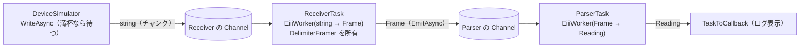
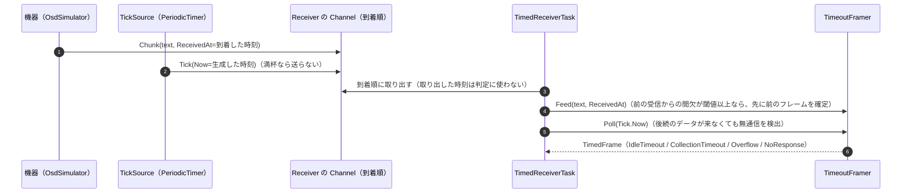

# Eiii.CommSim — 通信シミュレーター

通信機器から断片的に届く文字列（チャンク）を、**受信 Worker** がフレームにまとめ、**解析 Worker** が解析する。この流れを、実機を使わずに再現して確かめるシミュレーターです。7 つのシナリオを順に実行し、ログを表示します。

- 部品（フレーム確定・解析・Worker・模擬機器）は [`samples/Eiii.Comm`](../Eiii.Comm) にあります（名前空間は `Eiii.CommSim`）。このプロジェクトには、シナリオを並べた `Program.cs` だけがあります。
- 通信に固有の処理はすべてこちら側にあり、ライブラリ本体（`src/Eiii`）は通信の知識を持ちません。

```
dotnet run --project samples/Eiii.CommSim              # 全シナリオ（約 18 秒）
dotnet run --project samples/Eiii.CommSim -- delimiter # A～C だけ
dotnet run --project samples/Eiii.CommSim -- timeout   # D～G だけ
```

---

## 2 つの方式と、使い分け

| 方式 | 想定するコマンド | フレームが確定する条件 | 部品 |
|---|---|---|---|
| **デリミタ方式** | 通常のコマンド応答（CR などの終端がある） | 区切り文字を検出したとき | `DelimiterFramer`、`ReceiverTask`、`ParserTask` |
| **時間経過方式** | OSD 取得などの特殊コマンド（応答の内部に複数の CR を含み、全体の終端マーカーがない） | 時間の条件を満たしたとき | `TimeoutFramer`、`TimedReceiverTask`、`OsdParserTask` |

**コマンドの種類に応じてどちらを使うかは、アプリケーション側が決めます。** OSD 応答を CR で区切ると、1 つの応答がばらばらの行に分かれてしまうため、時間の条件でまとめます。

### デリミタ方式の流れ



- `DelimiterFramer` は、チャンクの境界とフレームの境界を無関係に扱います。区切り文字（既定は CR LF）がチャンクをまたいでも検出します。
- 区切り文字のない末尾は、正常終了（`CompleteInput`）のときに `IsComplete = false` のフレームとして渡し、Parser はエラー付きの結果を出します（捨てません）。キャンセル停止のときは framer に残り、再起動後に届くチャンクとつながります。

### 時間経過方式の 3 つの時間条件

| 条件 | 測る区間 | 満たしたとき | シナリオでの値 |
|---|---|---|---|
| `IdleTimeout`（Idle 方式） | **最後の受信**からの無通信時間 | フレームを確定（`IdleTimeout`） | 250ms |
| `CollectionTimeout`（Fixed 方式） | **最初の受信**からの経過時間 | フレームを確定（`CollectionTimeout`）。秒単位の打ち切り | 2 秒 |
| `ResponseTimeout` | 要求から**最初の受信**まで | `NoResponse` を通知（データなし）。フレーム確定の閾値ではない | 6 秒 |
| `MaxFrameLength` | 確定前のデータの長さ | そこまでのデータ全体を `Overflow` として出す（捨てない） | 1,024 文字 |

Idle 方式と Fixed 方式を両方指定すると、先に満たした方で確定します。これらの値は記憶に基づく概算で（約 300 文字、断片間は数十～100ms、応答まで最大約 5 秒）、実機で確かめた仕様ではありません。



**判定には、Chunk の受信時刻と Tick の生成時刻だけを使います。** Worker がキューから取り出した時刻は使いません。そのため、下流が詰まってキューで待たされても、フレームの境界は変わりません（テストで確認済み）。

---

## シナリオと実行結果

以下は実際の実行ログの要約です（時刻は実行のたびに変わります）。

| シナリオ | 操作 | 結果 |
|---|---|---|
| A. 正常終了 | `"TEMP=2"` `"3.5\r"` `"\nHUM=4"` … の順にチャンクを送り、`CompleteAllAsync` | TEMP=23.5、HUM=40、PRES=1013 に復元。区切り文字のない末尾 `TAIL=7` は「未完了フレーム」のエラー付き結果として届く |
| B. バックプレッシャー | Parser のキュー容量 1、解析 200ms で 6 件送る | 6 件目で機器の `WriteAsync` が約 200ms 待たされる。6 件すべてが順序どおりに届き、捨てたデータは 0 |
| C. キャンセル停止 | 4 フレームを送り、2 件目の解析中に `StopAllAsync` してから正常終了 | 解析中だった C=2 だけが失われ、C=1、C=3、C=4 が解析される |
| D. Idle 方式 | 約 300 文字（内部に CR 12 個）を 10～100ms の間欠で送る | 1 つの応答に確定し、内容は CR を含めて送信と一致 |
| E. Idle 方式の誤分割 | D と同じ応答の途中に 400ms の間欠を入れる | 2 つ（150 文字ずつ）に分かれる。本来は 1 件 |
| F. Fixed 方式 | E と同じ応答を、収集時間 2 秒で受ける | 1 つにまとまるが、確定は最初の受信から 2 秒後（Idle 方式より遅い） |
| G. 応答なし | 要求だけを送り、機器は応答しない | 6 秒後に `NoResponse` |

### Idle 方式と Fixed 方式の比較

| 観点 | Idle 方式 | Fixed 方式 |
|---|---|---|
| 確定までの遅れ | 短い（応答が終わってから閾値 ＋ Tick の周期程度） | 長い（応答の長さに関係なく収集時間だけ待つ） |
| 応答途中の間欠 | 閾値以上なら誤って分割する | 収集時間内なら分割しない |
| 長い応答 | 間欠が閾値未満なら全体を 1 つにまとめる | 収集時間を超えた分は打ち切られて分割される |
| 途切れなく送り続ける相手 | 確定しない（収集時間の上限との併用が必要） | 必ず一定時間で確定する |

---

## 既知の制約

- **時間条件による確定は、電文の完全性を保証しません。** 終端マーカーがないため、応答を最後まで受け取ったかは確認できません。
- `MaxFrameLength` は厳密な出力長の上限ではなく、Overflow を検出する閾値です（超えた原因のチャンクまで含めて出力するので、わずかに超え得ます。残りは別のフレームになります）。
- Chunk と Tick は同じ Channel に到着順で入る前提です。送り手の `WriteAsync` 自体が満杯で待たされた場合の投入順序は、Channel の実装に依存し、**検証していません**（シナリオとテストでは、Receiver のキューを大きくしてこの状況を避けています）。
- 経過時間の判定に実時刻（`DateTimeOffset`）を使っているので、時計の補正の影響を受け得ます。
- 判定の粒度は、Tick の周期（25ms）と OS のタイマー分解能に左右されます。
- デリミタ方式のバッファには上限がありません。
- キャンセル停止では、処理中のフレームや、1 つのチャンクから確定した後まだ出力していないフレームが失われ得ます。

## テスト

`tests/Eiii.CommSim.Tests`（34 件）です。

- `DelimiterFramer` と `TimeoutFramer` の単体テスト：時刻は合成値を渡すので、実時間に依存しません。閾値ちょうど（249 / 250ms）の境界、誤分割、Overflow、NoResponse を確認します。
- 結合テスト（実時間）：Receiver と Parser の独立性、バックプレッシャー、停止と正常終了の違い、キューで待たされても受信時刻で判定されること。
