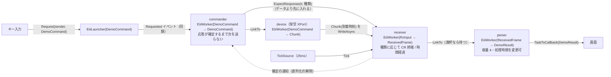

# Eiii.DemoConsole — 操作して観察するデモ

キーボードで架空の XPort 系機器へコマンドを送り、**要求 → 送信 → 受信 → フレーム確定 → 解析 → Callback** の流れを 1 つの画面で追うデモです。独立した Worker が並行して動く様子や、Channel の容量制限によるバックプレッシャーを、自分で操作しながら観察できます。

- 機器は模擬です（実機への接続はありません）。応答の内容と時間は、記憶に基づく概算や観察しやすさのための値で、実機の仕様ではありません。
- .NET 10 のコンソールアプリです。外部の UI ライブラリは使っていません。
- 通信の部品は [`samples/Eiii.Comm`](../Eiii.Comm)、Worker の仕組みはライブラリ本体（`src/Eiii`）を使います。デモに固有のコードはこのフォルダーにあります。

```
dotnet run --project samples/Eiii.DemoConsole
```

---

## 画面

コンソールが **100 桁 × 30 行以上**なら、全画面で表示します（約 0.2 秒ごとに書き換え）。

```
Eiii DemoConsole  架空 XPort（模擬・実機接続なし）                        15:22:58
#番号はアプリ内の追跡用 ID で、実機プロトコルが返す識別子ではない
---------------------------------------------------------------------------------------------------
Worker     状態              キュー       完了    補足
commander  稼働中            3/8          5       #6 応答確定待ち 0.4s
device     稼働中            0/4          5       無応答=OFF 長い間欠=OFF
receiver   稼働中            0/256        5       方式=CR 終端
parser     稼働中            4/4 満杯     2       処理時間 1000ms
要求: 受理 10 / 拒否 1    受信チャンク 10    確定 5    解析 2    Callback 2
---------------------------------------------------------------------------------------------------
[1]通常コマンド(CR終端)  [2]OSD取得(時間経過)  [3]通常x10(満杯で拒否)  [S]Parser処理時間 0/300/1000ms
[G]OSD途中に長い間欠(誤分割)  [N]機器を無応答に  [R]キャンセル再起動(処理中は失われ得る)
[Q]/[Esc]正常終了(受理済みをすべて処理してから終了)
------------------------------------------------------------ ログ（新しいものが下）
15:22:58.120 #6   [送信] 通常コマンド を機器へ送信。応答の確定を待つ（次のコマンドは送らない）
15:22:58.275 #6   [機器] 応答開始 10 文字を 2 チャンクで送る
15:22:58.276 #6   [受信] チャンク 5 文字（CR 0 個）到着→処理 0ms
...
```

（上の図は画面の構成を示すための例です。値は操作によって変わります。）

| 欄 | 意味 |
|---|---|
| 状態 | Worker の実際の Task の状態を、人が読みやすい言葉にしたもの（未起動 / 稼働中 / 停止(キャンセル) / 正常終了 / 異常終了） |
| キュー | Worker の入力キューに残っている数 / 容量。容量に達すると「満杯」 |
| 完了 | commander：応答待ちを終えたコマンドの数。device：応答を送り終えた数。receiver：確定したフレームの数。parser：解析を終えた数 |
| 補足 | commander：応答を待っている要求と経過時間。device：無応答・長い間欠の設定。receiver：現在の方式。parser：処理時間 |

コンソールが狭い場合や、出力をリダイレクトしている場合は、**行単位のログ表示**になります（出来事を 1 行ずつ出し、状態が変わったら約 1 秒ごとに `[状態]` 行を出します）。

### ログの段階

| 表示 | 何が起きたか | どこで起きるか |
|---|---|---|
| `[要求]` | Launcher が Commander のキューへ投入し、入った（受理）、または満杯で入らなかった（拒否） | 呼び出し元（キー入力）のスレッドで同期的に |
| `[送信]` | Commander が機器へコマンドを送り、応答の確定を待ち始めた | commander の Worker |
| `[機器]` | 機器が応答を送り始めた、または無応答モードで応答しなかった | device の Worker |
| `[受信]` | Receiver がチャンクを処理した。「到着→処理」は、到着してから処理されるまでの時間 | receiver の Worker |
| `[確定]` | Receiver がフレームを確定した（CR / IdleTimeout / NoResponse など） | receiver の Worker |
| `[待機]` | Commander の応答待ちが解除された（次のコマンドへ進める）、または停止で取り消された | commander の Worker |
| `[解析]` | Parser が解析を始めた / 終えた | parser の Worker |
| `[通知]` | Parser の出力に対して Callback（`TaskToCallback<DemoResult>`）が呼ばれた | parser の Worker から同期的に |
| `[操作]` | キー操作、停止・再起動・終了の経過 | — |

**`#番号` はアプリケーションの中で付けた追跡用の番号です。** 実機のプロトコルが返す識別子ではありません。プロトコルに要求 ID がないため、受信したデータには「その時点で応答を待っている要求」の番号を付けています（§「制約」を参照）。

---

## キー操作

| キー | 動作 | 内部で起きること | 画面で見えること |
|---|---|---|---|
| `1` | 通常コマンドを 1 件送る | Launcher → Commander のキュー → 機器が約 150ms 後に `TEMP=xx.5\r` を 2 チャンクで返す → CR で確定 | `[要求]` から `[通知] ... TEMP=21.5` まで、同じ番号で並ぶ |
| `2` | OSD 取得を 1 件送る | 機器が約 1.5 秒後に、約 300 文字・内部に CR を含む応答を 10～100ms 間隔のチャンクで返す → 無通信 250ms で確定 | `[受信]` が十数行続き、`[確定] [IdleTimeout] 300 文字`、`[解析] OSD 13 行 / 300 文字（完全性は未保証）` |
| `3` | 通常コマンドを 10 件続けて送る | Commander のキュー（容量 8）を超えた分は `Request` が false を返す | `[要求] ... 拒否（Commander のキューが満杯）` が出る |
| `S` | Parser の処理時間を 0 → 300 → 1000ms と切り替える | 解析が遅くなると Parser のキュー（容量 4）が埋まり、Receiver が Parser への出力で待つ | parser が「4/4 満杯」になり、receiver のキューが増える。`[受信]` の「到着→処理」が数百 ms に延びる |
| `G` | OSD 応答の途中に 400ms の間欠を入れる（オン / オフ） | 無通信の閾値（250ms）を超えるため、1 つの応答が途中で確定してしまう | `[確定] [IdleTimeout] 150 文字` が 2 回出る |
| `N` | 機器を無応答にする（オン / オフ） | 応答待ちの上限（通常 2 秒、OSD 6 秒）で NoResponse になり、直列化が解除される | `[確定] [NoResponse]`、`[通知] ... 応答なし` |
| `R` | すべての Worker をキャンセルで停止し、再起動する | 上流から 1 つずつ `StopAsync`（処理中のデータは失われ得る）→ 下流から `Start`。応答待ちは取り消される。キューに残っていた要求やチャンクは続きから処理される | `[待機] 停止により応答待ちを取り消した`、`[操作] 停止後: commander=停止(キャンセル) 残2 / ...` |
| `Q` / `Esc` | 正常終了して終わる | 上流から 1 つずつ `CompleteAsync`。上流から入力を閉じ、受理済みの要求をすべて処理してから、すべての Worker が終了する | parser のキューが 1 件ずつ減り、すべて「正常終了」になってから終わる |

標準入力をリダイレクトした場合は、文字をキーの代わりに読みます（`.` は 0.5 秒待つ）。例：`printf '1..2......q' | dotnet run --project samples/Eiii.DemoConsole`

---

## 内部の構成



- **commander** は 1 件ずつ送り、`ResponseTracker`（`TaskCompletionSource` による非同期の待機）で応答の確定を待ちます。待っている間も、receiver・parser・画面は独立して進みます。停止されると待機を取り消し、`finally` で後始末します。
- **直列化が解除される条件は、receiver が応答を確定したこと（CR / IdleTimeout）または NoResponse です。** parser の処理完了ではありません。そのため parser が遅くても、コマンドの送信は進みます。その結果、receiver が parser への出力で待たされ、チャンクが receiver のキューに溜まります（「到着→処理」が延びるのはこのためです）。
- **receiver** は、commander が先に入れる `ExpectResponse` に従って、通常コマンドには `DelimiterFramer`（CR）、OSD には `TimeoutFramer`（無通信 250ms、応答待ち 6 秒）を使います。通常コマンドの応答待ちの上限（2 秒）も receiver が Tick で判定します。次の応答待ちを始めるときに前の応答の未確定データが残っていれば、捨てずに `Leftover` として出します。
- **画面への表示**は、すべての Worker から `Channel<DemoEvent>` に送られ、描画ループ 1 本がコンソールへ書きます（複数のスレッドがコンソールを同時に触らない）。
- **起動・停止・完了の順序**は、`DemoSystem.Workers`（commander → device → receiver → parser）の並びに従い、このデモのコードで明示しています。R の停止と Q の完了は上流から 1 つずつ、起動は下流から行います。

---

## 試してみる

### 1. 同期の要求と非同期の処理の違い

`1` を押す。`[要求]`（受理）は押した瞬間に出ます。その後、約 150ms 遅れて `[機器]` → `[受信]` → `[確定]` → `[解析]` → `[通知]` が続きます。要求の受け付けと処理が別々に進んでいることが分かります。

### 2. 通常コマンドと OSD 応答の違い

`2` を押す。約 1.5 秒後から `[受信]` が十数行続きます（各チャンクには CR が 0～2 個含まれます）。最後のチャンクから 250ms 後に `[確定] [IdleTimeout] 300 文字` が 1 回だけ出ます。CR で区切らずに、1 つの応答としてまとめていることが分かります。

### 3. キューが満杯になる

`3` を押す。10 件のうち、Commander のキュー（容量 8）に入らなかった分が `拒否` になります。

### 4. バックプレッシャー

`S` を 2 回押して処理時間を 1000ms にしてから、`3` を押す。parser が「4/4 満杯」になり、receiver のキューが増えていきます。`[受信]` の「到着→処理」が数百 ms に延びます（開発時の実行では最大 845ms、receiver のキューは最大 41 件）。フレームの境界は到着時刻で判定するので、処理が遅れても変わりません。

### 5. 誤分割による取り違え（時間経過方式の制約）

`G` を押して長い間欠をオンにし、すぐに `2` と `1` を続けて押す。OSD 応答が 150 文字で途中確定し、#2（通常コマンド）が早く送られます。その結果、OSD 応答の残りの行が #2 の応答として扱われ、`[通知] ... 解析できない "SCR1 L07: ****..."` が数行出ます。その後に、#2 本来の応答 `TEMP=22.5` も #2 として届きます。

### 6. 無応答

`N` を押してから `1` を押す。約 2 秒後に `[確定] [NoResponse]` になり、次のコマンドへ進みます。

### 7. キャンセル再起動と正常終了の違い

`S` で処理を遅くし、`3` の後にすぐ `R` を押す。応答待ちが取り消され、「解析開始」の後に「解析完了」が出ないまま失われた要求があることが分かります（最後の集計で、受理された数より Callback の数が少なくなります）。

一方、`Q` で終わると、parser のキューが 1 件ずつ減っていき、すべての Worker が「正常終了」になってから終了します。

---

## 制約（時間方式とプロトコルに由来するもの）

- **`#番号` は追跡用の ID で、実機の識別子ではありません。** プロトコルに要求 ID がないため、受信したデータがどの要求の応答かは区別できません。
- **NoResponse の後に遅れて届いた応答は、次のコマンドの応答として扱われます**（テストで確認済み）。
- **OSD 応答が途中の長い間欠で誤分割すると、次のコマンドが早く送られ、応答の残りが次のコマンドのものとして扱われます**（操作例 5、テストで確認済み）。
- 時間経過方式で確定した応答は、完全に受信したことの証明にはなりません。
- R（キャンセル停止）では、処理中のコマンド・応答・フレームが失われ得ます。失われたコマンドは再送しません。
- **画面への表示に使う上限のない Channel（`Channel<DemoEvent>`）は、デモ向けの設計です。** 表示が遅れてもデータの処理を止めないことを優先しています。そのため長時間動かし続けると、表示されていない出来事が溜まり、メモリ使用量が増え続ける可能性があります。データを流すキュー（容量制限付き）とは扱いが異なります。

## 検証の状況

| 項目 | 状況 |
|---|---|
| 構成（画面以外）の自動テスト | `tests/Eiii.DemoConsole.Tests` の 12 件が Debug / Release で成功。直列化、NoResponse、遅れた応答の取り違え、誤分割、バックプレッシャー、再起動、正常終了 |
| 行単位表示での実行 | 標準入力から文字を流して実行し、上の操作例 1～7 に対応する動作をログで確認した |
| **全画面表示と、実際のキー入力による操作（再起動・正常終了を含む）** | **未検証**（開発環境では、対話的なコンソールでの実行を自動では確認できなかった。利用者による手動確認を次の工程として行う） |
| Windows 以外の OS | 未検証 |
